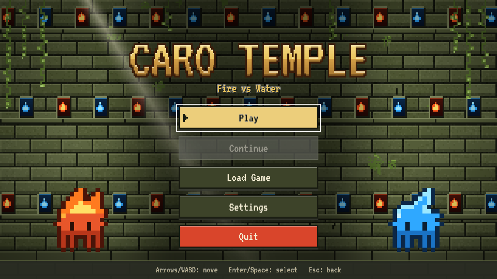
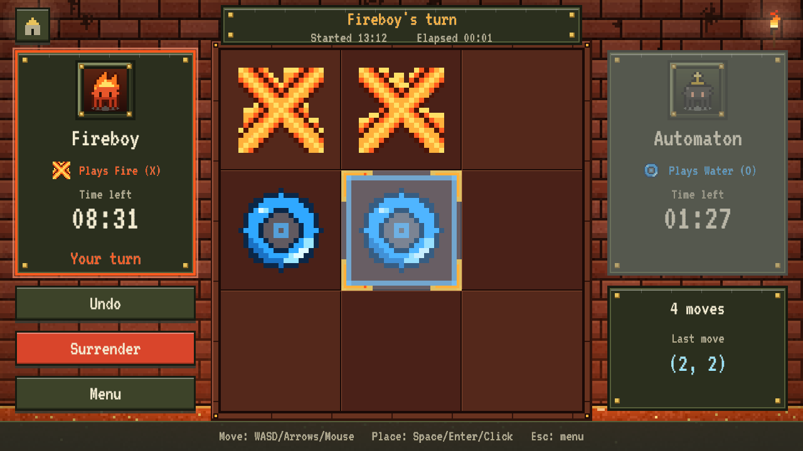

# Caro Temple

[](https://github.com/LLaammTTeerr/caro-temple/actions/workflows/ci.yml)

A pixel-art Caro (Gomoku / tic-tac-toe) game in C with a temple theme: **Fire (X) vs Water (O)**.



Two versions share one game core:

| Version | Binary | Dependencies |
|---|---|---|
| Graphical | `caro` | [raylib 5.5](https://www.raylib.com/), fetched automatically by CMake |
| Terminal | `caro_tui` | none: C standard library plus the OS console API (POSIX termios / Win32 console) |

## Features
- Boards **3x3** (3 in a row), **5x5** and **10x10** (5 in a row), each with its own temple background (Fire Shrine, Forest Temple, Water Sanctum). Optional rule: a five blocked at both ends does not win.
- **vs Computer** (Easy / Medium / Hard; Hard plays 3x3 perfectly) and **2 players** on one device.
- Player name and avatar (six pixel mascots) before each match.
- Mouse (hover + click), keyboard and Xbox-style gamepad:
  - **Player 1:** `W A S D` + `Space`
  - **Player 2:** arrow keys + `Enter`
  - **Menus:** `Esc` goes back; the on-screen Home button, the `Home` key or gamepad Start goes straight to the main menu; a match in progress stays in memory and **Continue** resumes it
  - **Gamepad:** D-pad / left stick moves, A places, B goes back; two pads give each player their own
  - **Gamepad support by version:** the GUI version supports gamepads everywhere raylib does. The terminal version supports them on Linux (joystick API) and Windows (XInput, loaded at runtime), but not on macOS.
- HUD with the match start time, a 10-minute clock per player, and the opponent's last move highlighted.
- Surrender, plus undo that the opponent has to accept (vs Computer, the AI always accepts).
- 10 save slots.
- AFK check: after 2 minutes without input the game asks "Do you want to keep playing?". With no answer within 30 s it autosaves and returns to the main menu.
- English (default) and Vietnamese.
- Procedural chiptune music and sound effects, with separate volume sliders and mute.
- Animated fire and water pieces, smooth scene transitions, and a reduced-motion option.



## Build
Requires CMake ≥ 3.16 and a C compiler (GCC, Clang, MSVC or MinGW-w64).

```sh
cmake -S . -B build -DCMAKE_BUILD_TYPE=Release
cmake --build build --config Release --parallel
ctest --test-dir build -C Release --output-on-failure
```

Then run `build/caro` (GUI) or `build/caro_tui` (terminal, at least 80x30). The `assets/` folder is copied next to the GUI binary.

- **Linux:** the GUI needs X11/GL/ALSA dev packages: `libx11-dev libxrandr-dev libxinerama-dev libxcursor-dev libxi-dev libgl1-mesa-dev libasound2-dev`.
- **Offline builds:** pass `-DFETCHCONTENT_SOURCE_DIR_RAYLIB=<raylib checkout>`.
- **Build only one version:** use `-DCARO_BUILD_GUI=OFF` or `-DCARO_BUILD_TUI=OFF`.

Saves and settings live in `%APPDATA%\caro` on Windows, `~/Library/Application Support/caro` on macOS, and `$XDG_DATA_HOME/caro` (or `~/.local/share/caro`) elsewhere. `CARO_DATA_DIR` overrides the location.

## Layout
```
core/   rules, AI, match state (clocks, undo, AFK), saves/settings, EN/VI strings: pure C99
gui/    raylib frontend: scenes, widgets, procedural pixel art, FX, synthesized audio
tui/    terminal frontend: double-buffered ANSI renderer, SGR mouse, Win32 console
tests/  unit tests for the core (ctest)
docs/   DESIGN.md (UI design system and screen specs), mockups
```

## Tests
- `ctest`: unit tests for rules, AI (Hard never loses 3x3, beats Easy on 10x10, < 300 ms per move), match state (clocks, undo, AFK), saves/settings, strings.
- `tests/e2e_gui.sh build` (Linux, needs Xvfb and libXtst): drives the real GUI with injected keyboard and mouse input through `tools/xinj.c`. It plays a 2-player match to a win, then a rematch, then pause → save, leave → load, and an AFK autosave, and checks the results. CI runs it on every push.
- CI matrix (`.github/workflows/ci.yml`): Linux GCC and Clang, macOS Apple Clang, Windows MSVC and MinGW-w64.

## Testing hooks
- `caro --scene <home|setup|profile|settings|saves|game|pause|undo|afk|surrender|gameover> [--board 3|5|10] [--pvp] --shot out.png` renders one scene and saves a screenshot. CI uses it headlessly.
- `CARO_AFK_IDLE` / `CARO_AFK_GRACE` (seconds) shorten the AFK timers.

Font: [VT323](https://fonts.google.com/specimen/VT323), SIL Open Font License (`assets/fonts/OFL.txt`).
